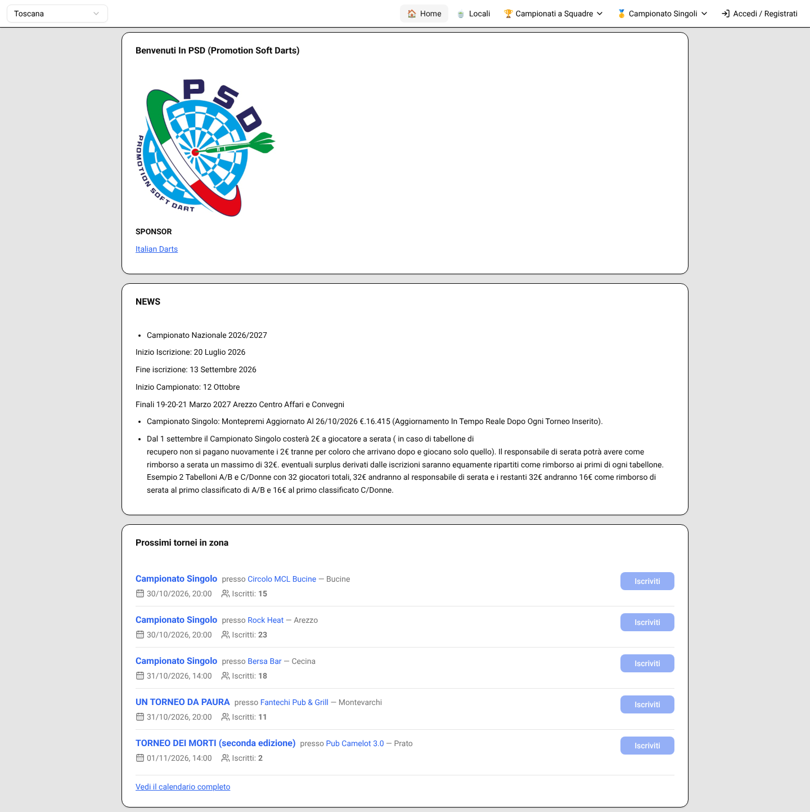
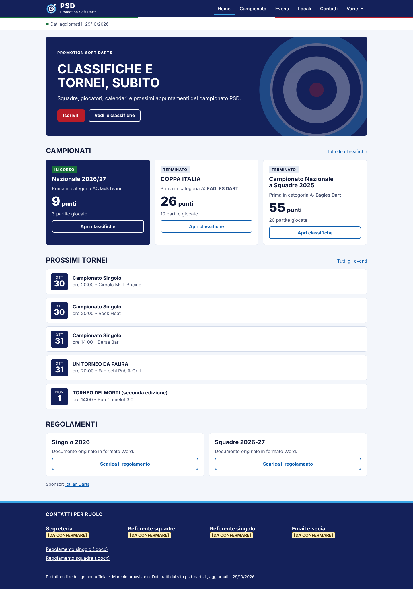
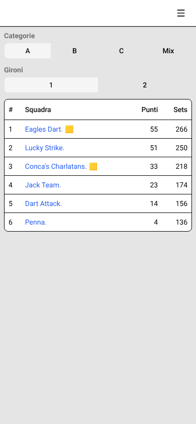
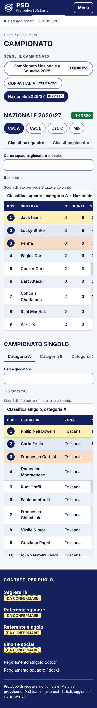
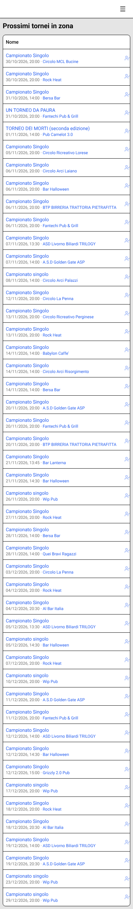
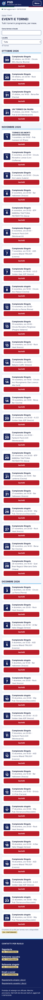

# Proposta di redesign – PSD · Promotion Soft Darts

Prototipo statico navigabile (`site/`, aprire con `python3 -m http.server` dentro la cartella). Dati reali del sito attuale aggiornati al 29/10/2026; tutto ciò che manca è marcato **[DA CONFERMARE]**. Il marchio nel prototipo è provvisorio (bersaglio con freccia), non il logo originale.

## Prima / dopo

| | Prima (freccette.pro) | Dopo (prototipo) |
|---|---|---|
| Home |  |  |
| Classifiche (mobile) |  |  |
| Tornei (mobile) |  |  |

## Scelte di design (dettaglio in `direzioni.md`)

- **Tema chiaro + navy**, palette del logo (azzurro, rosso, verde); tema scuro automatico. Contrasto AA verificato.
- **Scheletro identico su ogni pagina**: header con marchio sempre visibile, "Dati aggiornati il…", footer con contatti per ruolo.
- **Menu corto** (Home, Campionato, Eventi, Locali, Contatti, Varie); regolamenti e iscrizione in "Varie".
- **Campionato**: un solo selettore con stato Terminato/In corso, categorie A/B/C/Mix, tab Squadre/Giocatori/Calendario, ricerca, podio, tabelle con intestazione fissa e scroll laterale indicato su mobile.
- **Eventi** raggruppati per mese con filtro località; **Locali** con ricerca, filtro città e tasto "Chiama".
- Solo HTML/CSS/JS, nessuna dipendenza, font di sistema.

## Verifica (server locale, Chromium headless)

- 6 pagine × desktop/mobile: **nessun errore o warning in console**, nessuno scroll orizzontale.
- Lighthouse (accessibilità / best practice / SEO: **100** su tutte le pagine). Performance: Home mobile 100 / desktop 96; Campionato mobile 84 / desktop 100; Contatti 100/100; Eventi 100/100 (misurato prima degli ultimi ritocchi CSS). Il punteggio mobile di Campionato è penalizzato da un layout shift simulato (0,3) che nel browser reale misura 0,04.
- Misure fatte su server locale senza compressione: il sito pubblicato andrà rimisurato.

## Da confermare con il cliente (cambiano struttura o contenuto)

1. Regolamenti e "Come iscriversi" raccolti sotto "Varie".
2. Tre campionati a squadre uniti in un unico selettore (oggi tre blocchi di menu identici).
3. Nuove sezioni "Chi siamo" e contatti per ruolo (oggi assenti).
4. Testo dei regolamenti in pagina invece dei .docx esterni.

## Cosa serve dal cliente

- **Accessi/codice** del sito (React/Vite) per portare il design in produzione e correggere i dati sporchi (locale senza città, telefono al posto del nome, "1 macchine").
- **Contenuti**: contatti (segreteria, referenti squadre e singolo), email e social, testo "chi siamo", testi dei regolamenti, URL del modulo di iscrizione.
- **Logo in alta risoluzione** (oggi solo 250×250 JPEG su sfondo bianco) e l'og:image corretta (`/logo.png` oggi restituisce una pagina HTML).
- **Dati completi** di classifica giocatori e calendario per tutte le categorie/gironi (il prototipo ha solo la vista di default).
- Conferma del trattamento di nomi dei giocatori e telefoni dei locali (oggi pubblici sul sito).
