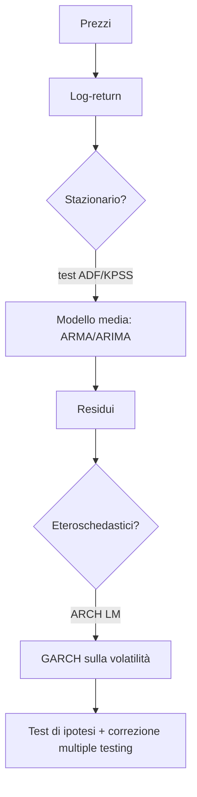

# 02 — Probabilità e Serie Storiche

**Obiettivo:** estrarre segnali puliti dal rumore dei dati di mercato, e sapere quando un "segnale" è solo caso.

## Mappa dei modelli

## Concetti

| Tema | Cosa | Strumento tipico |
|---|---|---|
| Stazionarietà | Media, varianza e autocovarianza non dipendono dal tempo. I prezzi non lo sono, i log-return (circa) sì | `adfuller`, `kpss` (statsmodels) |
| Autocovarianza / ACF / PACF | Dipendenza lineare tra `X_t` e `X_{t-k}` | `plot_acf`, `plot_pacf` |
| ARIMA(p,d,q) | AR (p) + differenziazione (d) + MA (q) | `statsmodels.tsa.arima.model.ARIMA` |
| GARCH(1,1) | `σ²_t = ω + α ε²_{t-1} + β σ²_{t-1}` — volatilità persistente | libreria `arch` |
| Cointegrazione | Combinazione lineare stazionaria di serie non stazionarie | Engle-Granger, Johansen (base del pairs trading) |
| Test di ipotesi | H0: nessun edge; p-value, potenza, errori I/II tipo | `scipy.stats`, `statsmodels` |

## Pratica sul segnale/rumore

- I rendimenti giornalieri azionari hanno **autocorrelazione quasi nulla**: aspettarsi che ARIMA "predica" i rendimenti è un errore comune. ARIMA è utile soprattutto su spread/residui; GARCH su volatilità e sizing.
- Il R² predittivo realistico su rendimenti è dell'ordine dell'1% o meno.

## Rischi statistici (cruciali per il progetto)

| Rischio | Descrizione | Contromisura |
|---|---|---|
| Data snooping | Si provano molte ipotesi e si tiene la migliore | Contare le ipotesi testate; holdout mai visto |
| Multiple testing | P-value ingannevoli con tanti test | Bonferroni / Benjamini-Hochberg; **Deflated Sharpe Ratio** |
| Overfitting | Parametri tarati sul rumore | Walk-forward, out-of-sample, penalizzazione complessità |
| Look-ahead bias | Uso di informazioni future | Allineamento temporale rigoroso, `shift(1)` sui segnali |
| Survivorship bias | Dataset senza titoli delistati | Dati point-in-time |

## Esercizi minimi

1. ADF su prezzi vs log-return di un ETF: interpretare i p-value.
2. Fit GARCH(1,1) su un indice e confrontare la volatilità condizionale con la realizzata.
3. Backtest di un segnale casuale su 1000 serie: osservare il "miglior" Sharpe ottenuto per solo caso.

## Risorse suggerite

- Tsay, *Analysis of Financial Time Series*.
- Hamilton, *Time Series Analysis* (riferimento).
- López de Prado, *Advances in Financial Machine Learning* (DSR, purged CV).
- Bailey & López de Prado, *The Deflated Sharpe Ratio* (paper).
