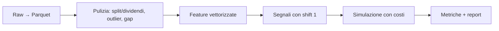

# 03 — Stack Tecnologico & Backtesting (Python)

**Obiettivo:** conoscere gli strumenti per elaborare dati storici in modo efficiente e riproducibile, e scegliere un framework di backtest.

## Stack

| Libreria | Ruolo | Note |
|---|---|---|
| NumPy | Array numerici, vettorizzazione | Base di tutto |
| Pandas | Serie temporali, resample, rolling | `DatetimeIndex` sempre tz-aware (UTC) |
| SciPy | Statistica, ottimizzazione | `scipy.stats`, `scipy.optimize` |
| statsmodels | ARIMA, regressioni, test (ADF, coint) | Modulo 02 |
| arch | GARCH | Volatilità |
| Polars / DuckDB | Dataset grandi | Alternativa a Pandas per volumi elevati |
| Parquet (pyarrow) | Storage colonnare dei dati storici | Molto più veloce di CSV |

## Framework di backtesting

| Framework | Pro | Contro | Uso consigliato |
|---|---|---|---|
| vectorbt | Velocissimo (vettorizzato), ottimo per sweep di parametri | Meno realistico sull'esecuzione | Ricerca rapida |
| backtrader | Event-driven, maturo, broker simulato | Manutenzione ridotta, lento | Prototipi event-driven |
| Zipline-reloaded | Pipeline point-in-time | Setup pesante | Ricerca cross-sectional |
| QuantConnect Lean | Event-driven, dati e broker integrati, C# e Python | Curva di apprendimento, ecosistema proprio | Produzione / allineamento a stack .NET |
| Motore custom minimale | Controllo totale, testabile | Da costruire e mantenere | Quando servono costi e regole su misura |

## Linee guida di codice per dataset storici



| Regola | Motivo |
|---|---|
| Vettorizzare; evitare `for` su righe e `iterrows()` | Ordini di grandezza più veloce |
| Dtype espliciti (`float32` dove basta, `category`) | Memoria |
| Leggere solo le colonne/righe necessarie (Parquet + filtri) | I/O |
| Mai mutare il dato raw; pipeline pura raw → processed | Riproducibilità |
| Seed fissati, versioni pinnate (`requirements.txt` / lock) | Riproducibilità |
| Segnali con `shift(1)` e test anti look-ahead | Evitare bias |
| Prezzi aggiustati per split e dividendi | Rendimenti corretti |
| Costi sempre inclusi: commissioni + spread + slippage | Evitare edge illusori |
| Funzioni pure + test (`pytest`) su ogni trasformazione | Fiducia nei dati |

## Esempio minimo (pattern, non strategia)

```python
import pandas as pd

px = pd.read_parquet("data/spy.parquet", columns=["close"])["close"]
ret = px.pct_change()
signal = (px.rolling(50).mean() < px).astype(int).shift(1)   # shift: niente look-ahead
cost = signal.diff().abs().fillna(0) * 0.0005                  # 5 bps per turnover
strat = signal * ret - cost
sharpe = strat.mean() / strat.std() * (252 ** 0.5)
```

## Metriche base

| Metrica | Nota |
|---|---|
| Sharpe annualizzato | Da correggere per multiple testing (DSR) |
| Max drawdown, Calmar | Rischio di coda reale |
| Turnover, hit rate, profit factor | Diagnostica |
| Tempo in mercato | Contesto per il Sharpe |

## Esercizi minimi

1. Convertire 5 anni di dati giornalieri CSV in Parquet e misurare i tempi di lettura.
2. Replicare lo stesso backtest in vectorbt e in codice Pandas puro; confrontare i risultati.
3. Aggiungere costi crescenti e osservare a che livello l'edge sparisce.
