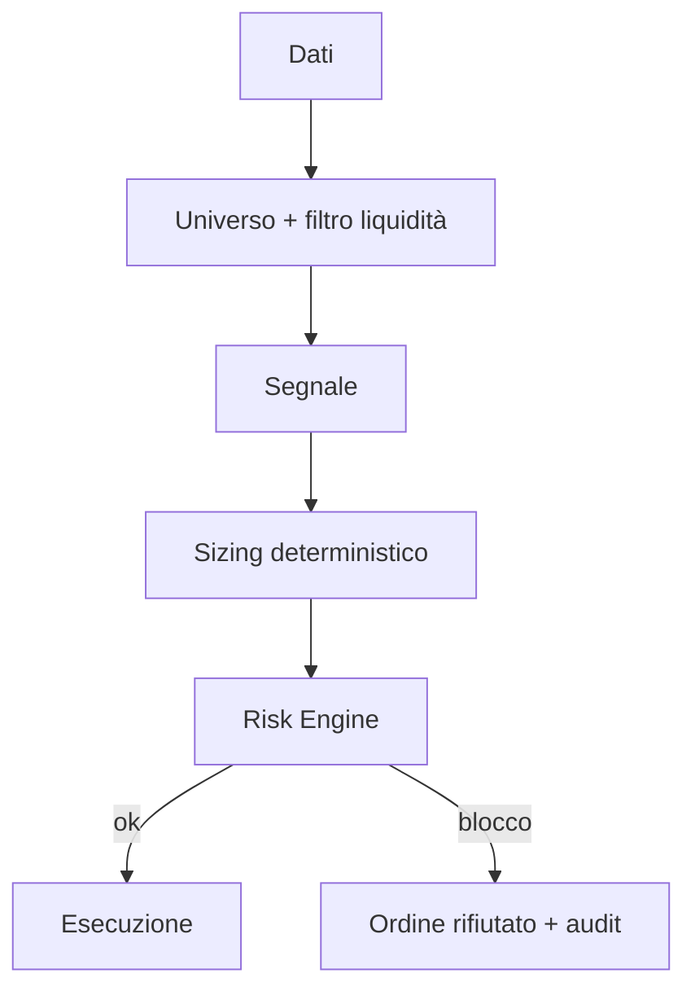
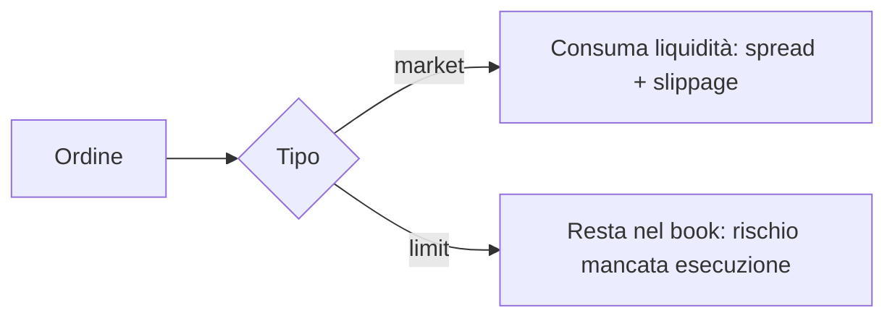

# 04 — Strategie e Microstruttura

**Obiettivo:** conoscere le famiglie di strategie, come gestire il rischio (VaR) e come funziona l'esecuzione sul mercato.

## Famiglie di strategie

| Strategia | Idea | Segnale tipico | Rischio principale |
|---|---|---|---|
| Statistical Arbitrage / Pairs Trading | Due titoli cointegrati; si scommette sul ritorno dello spread alla media | z-score dello spread (entrata |z|>2, uscita z≈0) | Rottura della cointegrazione (regime change) |
| Mean Reversion | I prezzi tornano verso una media di breve periodo | RSI basso, Bollinger, z-score | "Coltello che cade" in trend forti |
| Momentum / Trend Following | Ciò che sale tende a salire (medio periodo) | Rendimento 12-1 mesi, breakout, medie mobili | Inversioni brusche (momentum crash) |

### Pairs Trading — passi

1. Selezione coppie (stesso settore, correlazione alta) su finestra *in-sample*.
2. Test di cointegrazione (Engle-Granger) + hedge ratio per regressione.
3. Spread `S = A − β·B`, standardizzato in z-score rolling.
4. Entrata/uscita su soglie, stop su |z| eccessivo e su rottura della relazione.
5. Ri-test periodico (walk-forward): le coppie decadono.

## Gestione del rischio: VaR

| Metodo | Come | Pro | Contro |
|---|---|---|---|
| Storico | Percentile dei rendimenti passati | Nessuna ipotesi di distribuzione | Dipende dalla finestra |
| Parametrico | `VaR = −(μ − z·σ)·V` assumendo normalità | Semplice | Sottostima le code grasse |
| Monte Carlo | Simulazione (es. GBM, modulo 01) | Flessibile | Costo computazionale, dipende dal modello |

Il VaR dice "perdita massima al livello 95%/99%" ma **non** cosa accade oltre: affiancare **Expected Shortfall (CVaR)** e limiti rigidi (max drawdown, esposizione, kill switch) applicati da codice deterministico.

## Microstruttura: order book

| Elemento | Significato |
|---|---|
| Bid / Ask | Miglior prezzo di acquisto / vendita |
| Spread | `ask − bid`: costo implicito di attraversare il book |
| Profondità | Volume disponibile a ciascun livello |
| Ordine a mercato | Esegue subito, paga lo spread, può slittare |
| Ordine limite | Fissa il prezzo, non è garantita l'esecuzione |
| Slippage | Differenza tra prezzo atteso ed eseguito (cresce con size/volatilità) |
| Impatto di mercato | Ordini grandi muovono il prezzo (modello a radice quadrata) |

## Implicazioni per il backtest

- Modellare spread e slippage in funzione di volatilità e volume (default conservativo: assumere il costo peggiore plausibile).
- Limitare la size a una frazione del volume medio giornaliero (es. ≤1%).
- Evitare strategie la cui redditività svanisce con un modesto aumento dei costi.

## Risorse suggerite

- Chan, *Algorithmic Trading* e *Quantitative Trading* (mean reversion, pairs).
- Harris, *Trading and Exchanges* (microstruttura).
- Jorion, *Value at Risk*.
- Moskowitz, Ooi, Pedersen, *Time Series Momentum* (paper).
