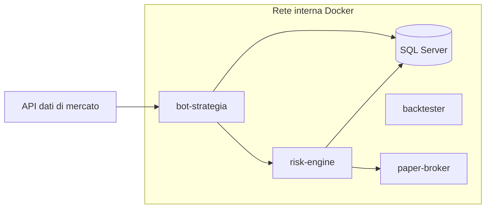

# 05 — Infrastruttura e Automazione

**Obiettivo:** eseguire i bot in container isolati, monitorarli, e integrare API di dati e agenti esterni in sicurezza.

## Architettura di runtime



Principio: il **risk-engine** è un servizio separato, con proprio utente/permessi; i bot lo chiamano ma non possono modificarlo né spegnerlo.

## Setup Docker

`Dockerfile` (bot Python):

```dockerfile
FROM python:3.12-slim
WORKDIR /app
COPY requirements.lock .
RUN pip install --no-cache-dir -r requirements.lock
COPY src/ ./src
RUN useradd -r bot && chown -R bot /app
USER bot
CMD ["python", "-m", "src.main"]
```

`docker-compose.yml` (estratto):

```yaml
services:
  bot-strategia:
    build: .
    read_only: true
    cap_drop: [ALL]
    security_opt: ["no-new-privileges:true"]
    networks: [internal]
    env_file: .env          # mai committato
    restart: unless-stopped
    deploy:
      resources:
        limits: { cpus: "1.0", memory: 1g }
networks:
  internal:
    internal: true          # nessuna uscita diretta
```

| Pratica | Motivo |
|---|---|
| Utente non-root, `read_only`, `cap_drop: ALL` | Riduce la superficie d'attacco |
| Rete `internal` + proxy/egress limitato | Il bot raggiunge solo ciò che serve |
| Segreti via env/secret manager, mai nell'immagine | Evita leak |
| Immagini con versioni pinnate | Riproducibilità |
| Limiti CPU/RAM | Un bot impazzito non satura l'host |
| `healthcheck` per servizio | Restart e alert affidabili |

## Comandi di monitoraggio

| Scopo | Comando |
|---|---|
| Porte in ascolto (TCP/UDP, numeriche) | `ss -tuln` |
| Con processo associato | `ss -tulnp` |
| Container attivi, formato compatto | `docker ps --format "table {{.Names}}\t{{.Status}}\t{{.Ports}}"` |
| Solo nome e immagine | `docker ps --format "{{.Names}}: {{.Image}}"` |
| Uso risorse | `docker stats --no-stream` |
| Log recenti di un bot | `docker logs --tail 100 -f bot-strategia` |
| Stato health | `docker inspect --format '{{.State.Health.Status}}' bot-strategia` |
| Reti e membri | `docker network inspect <rete>` |

Verifica base: da `ss -tuln` devono comparire solo le porte previste (es. dashboard su 127.0.0.1); qualunque altra è un'anomalia da investigare.

## Integrazione API

| Flusso | Approccio |
|---|---|
| Dati storici | Batch giornaliero → Parquet/SQL, versionati con hash |
| Dati real-time | WebSocket con riconnessione/backoff, buffer, deduplica, timestamp UTC |
| Broker | Interfaccia astratta `IBroker`; **solo implementazione simulata** in fase iniziale |
| Agenti esterni / LLM | Chiamate via client dedicato, input/output loggati (versione modello, timestamp); gli LLM non decidono su rischio, sizing o validità statistica |

Regole di resilienza: timeout espliciti, retry con backoff esponenziale e jitter, circuit breaker, idempotenza degli ordini, rate limiting rispettato, validazione dello schema delle risposte.

## Osservabilità e sicurezza

| Area | Cosa fare |
|---|---|
| Audit | Ogni decisione: input, output, versione, timestamp (tabella append-only) |
| Alert | Drawdown oltre soglia, anomalie dati, kill switch attivato → HITL |
| Backup | Dump DB periodici, test di restore |
| Aggiornamenti | Scansione immagini, dipendenze aggiornate in CI |
| Kill switch | Flag globale letto dal risk-engine, azionabile solo dall'umano |

## Esercizi minimi

1. Containerizzare un bot "hello" con utente non-root e `read_only`; verificare con `docker ps --format` e `ss -tuln`.
2. Simulare la caduta del feed dati: il bot deve degradare in sicurezza (nessun ordine).
3. Provare a far raggiungere al bot una destinazione non autorizzata: la rete `internal` deve bloccarla.
