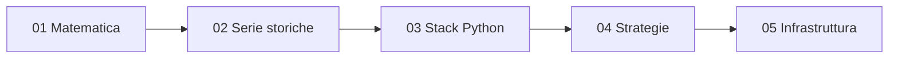

# Quant Roadmap — indice

Percorso di studio e sviluppo per un sistema di trading quantitativo automatizzato (Python, Docker). Ordine consigliato: dall'alto in basso.

| # | Modulo | Contenuto | Obiettivo |
|---|---|---|---|
| 01 | [Matematica e Calcolo Stocastico](01_math_stochastics.md) | Moto Browniano, SDE, Lemma di Itô, GBM | Modellare la dinamica dei prezzi |
| 02 | [Probabilità e Serie Storiche](02_statistics_timeseries.md) | Stazionarietà, ARIMA, GARCH, test di ipotesi, multiple testing | Segnali puliti dal rumore |
| 03 | [Stack Python & Backtesting](03_python_quant_stack.md) | Pandas, NumPy, SciPy, statsmodels, framework di backtest | Elaborazione efficiente e riproducibile |
| 04 | [Strategie e Microstruttura](04_strategies_market_structure.md) | Pairs trading, mean reversion, momentum, VaR, order book | Strategie e rischio |
| 05 | [Infrastruttura e Docker](05_infrastructure_docker.md) | Container, `ss -tuln`, `docker ps --format`, API | Esecuzione isolata e monitorata |

## Legame con le milestone del progetto

| Milestone | Moduli di riferimento |
|---|---|
| M1 dati + backtest con costi | 03, 04 (microstruttura) |
| M2 validazione deterministica (holdout, multiple testing) | 02, 03 |
| M3 Risk Engine + broker simulato + paper trading | 04 (VaR), 05 |
| M4 monitor di decadimento + dashboard | 02, 05 |
| M5 agenti LLM | 05 (integrazione API) |

> Nota: materiale educativo, non consulenza finanziaria. Fase iniziale: solo paper trading.
